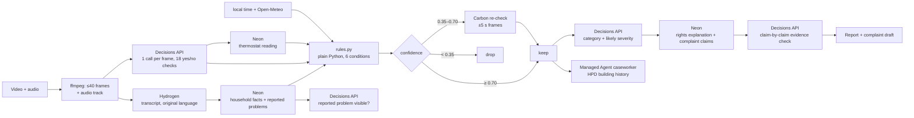
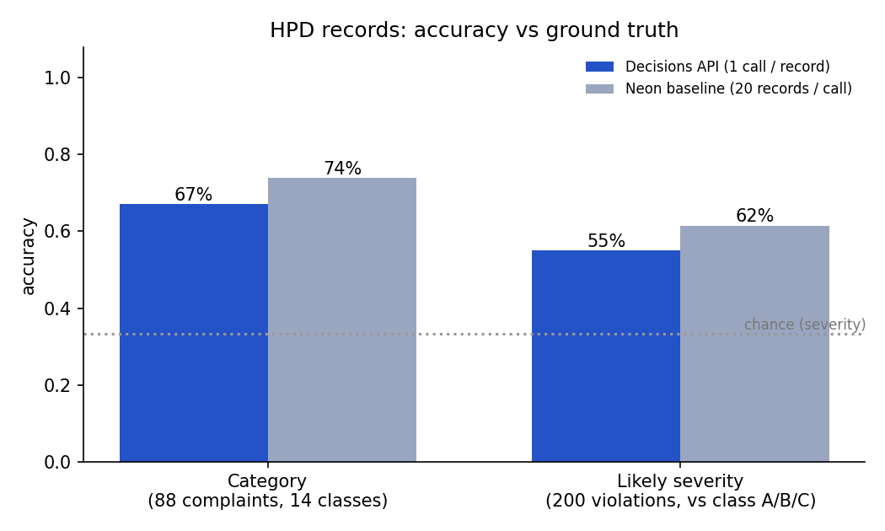
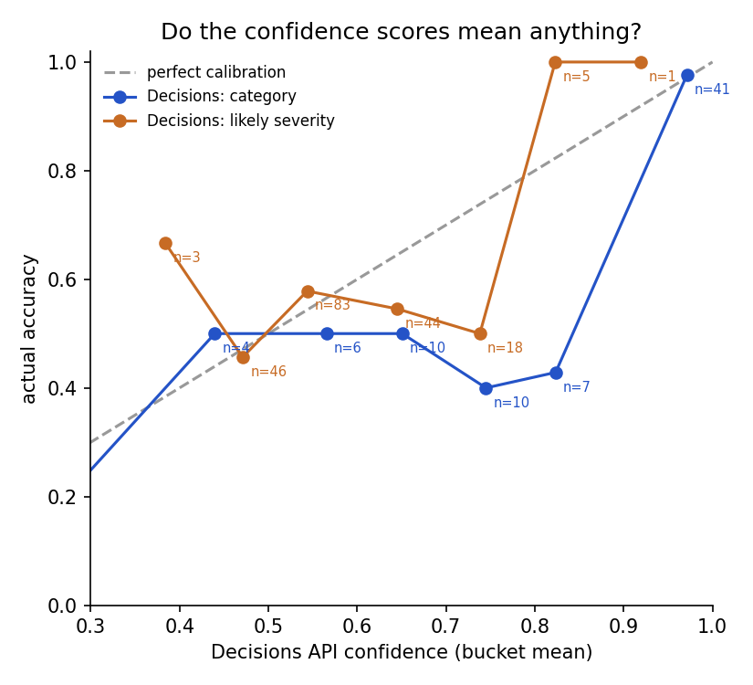

# Walkthrough

**Landlords have lawyers. Tenants have a phone.**

A NYC tenant films their apartment and says who lives there (in any language). Walkthrough
returns which problems likely break NYC housing rules and which don't, with timestamped evidence
frames, a plain-language explanation in the tenant's language, and an English complaint draft the
tenant reviews and files through 311 themselves.

Built solo at the Gemini 4 NYC Hackathon (Problem Statement Two). All code written today.

## The problem

NYC tenants often don't know which problems the law actually covers. Window guards are required only
if a child 10 or younger lives there (in a building with 3+ apartments); heat rules depend on the time
of day and the outdoor temperature. And a 311 complaint without evidence is just the tenant's word.

The answer depends on **both** the video and what the tenant says: the same unguarded window is a
violation if "my son is 6" and not a violation if "no kids live here". The app shows this live with
**Run again without audio**, which re-runs the same video with the spoken facts removed and shows the
two results side by side.

## How it works



1. **Ingest** (`ingest.py`): 1 fps (clips over 40 s are sampled evenly to 40 frames), near-duplicate frames skipped, audio extracted.
2. **Transcribe** (`transcribe.py`): Hydrogen, original language, with timestamps.
3. **Household facts** (`household.py`): Neon → children's ages, building size, borough, problems the tenant mentioned (with when they said them). Unclear facts default to the cautious answer + "please confirm".
4. **Frame checks** (`frame_checks.py`): one Decisions API call per frame with all 18 yes/no questions (quality, window/guard, ceiling/detectors, thermostat, stains, drips, dark growth, peeling paint, rust, room type), low resolution.
5. **Thermostat** (`thermostat.py`): if a frame shows one, Neon reads the number.
6. **Context** (`context.py`): local time (America/New_York) and outdoor temperature (Open-Meteo).
7. **Rules** (`rules.py`): plain Python, no LLM. Each rule cites its official source.
8. **Route** (`classify_route.py`): confidence ≥ 0.70 → keep; 0.35–0.70 → Carbon re-checks the frames around it (max 3 per clip) → keep / drop / "film again"; < 0.35 → drop.
9. **Classify**: one Decisions call per kept finding: HPD category (choice over the 14 HPD order categories used in `data/hpd_reference.json`) + likely severity (3-level score), medium-resolution evidence frame.
10. **Reported problems, checked as VIDEO** (`reported.py`): (R1) Neon finds every time the tenant talks about each
    problem and the object to look for ("flush" → toilet); one Decisions call over all frames finds where that object is on
    screen. Clips are taken where the object is visible within ±10 s of a mention (the frame with the most motion, i.e. the
    item being used); if it isn't near any mention, the whole video is searched and the best 1–2 stretches where it appears
    are checked. "Not shown" is used only if the object never appears anywhere in the video. (R2) For each moment, ffmpeg cuts a 9 s clip (t−3 s to t+6 s, with sound) and the Decisions API watches it as a
    **video** block: supports / contradicts / not_shown, where "contradicts" requires the item to be clearly used AND working
    (flush pressed AND water flushes). (R3) Any "contradicts", or any answer under 0.75, goes to Carbon (MEDIUM), which
    watches the clip and has the final word. (R4) HPD verdict from `data/hpd_reference.json`. Video contradicts → bucket 2
    ("You said the toilet doesn't flush, but in your video it flushes normally"). Visual findings the tenant mentioned are
    merged into that report (never shown twice); water in a sink/tub/bowl is dropped by a "normal use?" Decisions check.
    `scripts/check_buckets.py` is the regression test (problem | source | video check | HPD verdict | bucket | decided by).
11. **Write + verify** (`write_verify.py`): Neon writes plain-language card text and the complaint as separate first-person factual claims; the Decisions API checks every claim against its evidence frame and the tenant's words; unsupported claims are removed, and an item with no surviving claim goes to "Please confirm or film again". Then, from the **final** buckets only: the complaint lists every bucket 1 and 3 item (nothing from "Please confirm"), and a second Neon call writes the rights explanation in the tenant's language (buckets 1+3 = likely the landlord's job, bucket 2 = likely not covered, and "We weren't sure about N thing(s): please film again or confirm" when bucket 4 has items).
12. **Verdicts + buckets** (`verdict.py`, `data/hpd_reference.json`): every report is sorted into
    "You reported it, and it's likely a violation" / "You reported it, but it's likely not a violation" /
    "We found it on your video, and it's likely a violation" (+ "Please confirm or film again"), most serious first.
    The reference is built from HPD's own data dictionary (Order Number tab of the violations dataset): 26 conditions,
    each with its HPD order numbers, category, law text, a plain-language rule and its conditions (child ages, 3+ units),
    plus 3 "not covered or unclear" entries (tenant-owned appliances, a single stove burner, noisy/slow appliances).
    `rules.py` stays the source of truth for its 6 rules (now tagged with their HPD order numbers). Each tenant-reported
    problem gets one Decisions call: closest reference entry (choice over all ids + "none") + likely severity; the
    verdict follows the entry (owner must fix and conditions met → likely violation; a not-covered entry → its verdict;
    no match → "We're not sure this is covered. You can still report it to 311."). One Decisions call per clip asks
    "did the tenant mention this?" for every video finding. Cards are written in plain language
    (What / Where / Why / What to do); "Why" comes only from the entry's plain rule, and the source line shows the
    HPD order (e.g. "HPD order 790 · §27-2043.1").
13. **Caseworker** (`caseworker/`): a Managed Agent looks up the building's HPD violation history in the background.

## Which model does what, and why

| Model | Job |
|---|---|
| **Gemini 4 Hydrogen** (`gemini-4-hydrogen`) | Fast: transcribes the audio in its original language, with timestamps. |
| **Gemini Decisions API** (`gemini-decision-1`) | Decides everything: frame quality, what's in each frame, where a reported object appears, what a video clip shows (supports / contradicts / not shown), whether water is normal use, which HPD reference entry fits, category, likely severity, whether the tenant mentioned a problem, and whether each complaint claim is supported. Calibrated 0–1 confidence on every answer. |
| **Gemini 4 Neon** (`gemini-4-neon`) | Understands and writes: household facts from speech, when each problem is mentioned, thermostat reading, plain-language cards, rights explanation in the tenant's language, complaint claims in English. |
| **Gemini 4 Carbon** (`gemini-4-carbon`) | Only steps in when the system is unsure: re-checks frames around a medium-confidence finding, and watches the clip when the Decisions API says a reported problem is contradicted or is under 0.75 confident (its answer is final). |
| **Managed Agent** (`antigravity-preview-09-2026`) | Caseworker: runs our `hpd-lookup` skill in a Google-hosted sandbox against NYC Open Data, and marks which findings are already open violations for the building. |

Thinking levels: Hydrogen and Neon LOW (Neon took 13 s for a one-word reply at its default; 2.5 s at LOW).
Carbon MEDIUM: on the same re-check, HIGH took 265 s, MEDIUM 17 s, LOW 4.5 s, all with the same verdict.

**The text models only write; the Decisions API decides.**

## Decisions API usage

- `client.decisions.create(model="gemini-decision-1", input=[text, image or video...], questions={...})` on `v1beta`.
- **All of a frame's questions in ONE call** (18 yes/no questions with true/false criteria).
- **Video input:** 9 s clips (with sound) are sent as `{"type": "video", "data": <base64>, "mime_type": "video/mp4"}` blocks.
- Question types used: `noul` (yes/no), `choice` (HPD categories; HPD reference entry; supports/contradicts/not_shown),
  `score` (3-level likely severity).
- Resolution `low` for frame scans, `medium` for evidence frames and clips.
- Confidence drives routing (keep / Carbon / drop), Carbon adjudication of clips (< 0.75), and the claim filter
  (P(supported) < 0.5 → removed).
- Measured on 4 test videos (18–70 s): 21–55 Decisions calls / 345–910 questions, 1 Hydrogen, 4–5 Neon, 0–2 Carbon,
  about 45–100 s end to end; results appear as soon as findings are ready, the complaint finishes after.

Every call is logged (model, step, purpose, questions, ms, key output, media stripped) and shown in the app
under **How this report was made**, with a per-model summary and a downloadable log.

## Managed Agent caseworker

`caseworker/AGENTS.md` + `caseworker/skills/hpd-lookup/` (SKILL.md + a stdlib Python script) are sent as inline
environment sources to `client.interactions.create(agent="antigravity-preview-09-2026", environment={"type": "remote", ...})`.
The agent normalizes the address, queries HPD violations (NYC Open Data `wvxf-dwi5`), and returns JSON: open
violations by class, recent open violations, and which of our findings are already open. It starts as soon as findings
are ready and the **Building history** card appears when it finishes (~30–45 s). Tested with 220 W 26th St, Manhattan
(2 violations on record, 1 open, class A). If the agent fails, the app falls back to running the same script directly
and labels the card "Direct Open Data lookup" (the fallback was not needed in testing).

## Evaluation

**On real NYC HPD records** (text only, public NYC Open Data; details in [`eval/results.md`](eval/results.md)):

| Task | n | Truth | Decisions API | Neon baseline |
|---|---|---|---|---|
| HPD category (14 classes) | 88 | category the complaint was filed under (`ygpa-z7cr`) | 67% | 74% |
| Likely severity (3 levels) | 200 | HPD class A/B/C of real violations (`wvxf-dwi5`) | 55% | 62% |
| Category, **Decisions confidence ≥ 0.9** | 41 of 88 | same | **98%** | n/a |

Honest read: on plain text, a Neon call labelling 20 records at once beat one Decisions call per record on raw
accuracy. What the Decisions API gives us is a confidence that means something: for category, answers at ≥ 0.9
confidence are right 98% of the time; the misses are inputs that are genuinely ambiguous. That is what the pipeline
routes on (keep / Carbon re-check / drop). Likely severity is our weak spot (it under-calls HPD class C); it is
logged as an open item in [`eval/FAILURES.md`](eval/FAILURES.md) and was not tuned on the test set.

Note: this eval was run before the app switched to the HPD order categories in `data/hpd_reference.json`; it scored the
14 complaint categories of `ygpa-z7cr`. Re-scoring with the order categories (joining each violation's `ordernumber` to
`data/hpd_orders_all.json`) is not done yet.

 

**Bucket regression test** (`scripts/check_buckets.py`, 4 real videos, all expectations met): "flush doesn't work" but the
video shows it flushing → bucket 2 (Decisions API → Carbon: "water rushes into the toilet bowl and flushes normally");
"no hot water" (not shown) → 1; toilet shown but never flushed → 1; water in a sink → not a leak; washer leaking → 1;
jammed window → 1; loud/slow dishwasher → 2; stove burner → 4 ("please confirm").

**On video:** `eval/eval_clips.py` (full pipeline vs video-only vs one-call Neon baseline, match = same rule within ±3 s)
is ready but not yet run: we don't have a labelled clip set yet. What we have shown on real footage
(`venue_01`, a 70 s walkthrough, 4 adults, no children): with the spoken facts, the 3 unguarded windows are
correctly **not violations**; with audio ignored, the same frames give **1 violation + 2 "film again"**.
Same video, different words, different answer.

**Failure log:** [`eval/FAILURES.md`](eval/FAILURES.md): Neon 13 s → 2.5 s (thinking LOW); Carbon re-check
265 s → 17 s (MEDIUM, 3 frames, deadline), end-to-end ~5 min → 36 s; deadline errors no longer retried;
claim check now demotes unverified findings; severity under-calls class C (open).

## Limitations (said plainly)

- On video, it looks for **6 common conditions** (window guards, heat day/night, smoke/CO detectors, leaks, mold, peeling paint).
  Problems the tenant reports are judged against the 26 conditions in `data/hpd_reference.json`. Not all housing law.
- A video can only show what was filmed: water temperature, noise, or a problem that only happens sometimes may be "not shown".
- **Not legal advice.** We output a *likely* severity, never the official HPD class (HPD assigns that on inspection).
- **No health claims.** For mold we say "condition observed".
- **The tenant files**, never the app: the complaint is a draft to review and submit through 311.
- Smoke/CO: not seeing a detector in one clip proves nothing, so it is always "please confirm", never a violation.
- The thermostat reading is a photo of the tenant's thermostat, not an official measurement.
- Evaluated on HPD records (text) and a handful of clips; no large labelled video set yet.

## How to run

Requirements: Python 3.11+, ffmpeg on PATH, a Gemini API key.

```powershell
pip install google-genai fastapi uvicorn python-multipart python-dotenv pandas matplotlib pillow requests reportlab
copy .env.example .env        # then put your GEMINI_API_KEY in .env (never commit it)
python scripts/smoke_test.py  # one call to each model
python scripts/warmup.py      # before a demo: wake every model
uvicorn server:app --port 8000
# open http://localhost:8000
```

Other entry points:
- `python scripts/run_pipeline.py data/raw/clip.mp4 [--intro "..."] [--video-only]`: steps 1–7 from the command line.
- `python eval/eval_hpd.py`: the HPD records eval (~300 calls).
- `python eval/eval_clips.py`: full vs video-only vs one-call baseline on `eval/labels.csv` (labels written before running the system).

Repo map: `config.py` (all model names + thresholds) · `models.py` (wrappers, retry 1/2/4 s, logging) · `ingest.py` ·
`transcribe.py` · `household.py` · `frame_checks.py` · `thermostat.py` · `context.py` · `rules.py` · `classify_route.py` ·
`reported.py` · `write_verify.py` · `pipeline.py` · `call_log.py` · `server.py` · `static/index.html` · `caseworker/` · `eval/`.

Rule sources: [heat (311)](https://portal.311.nyc.gov/article/?kanumber=KA-01036) ·
[window guards (HPD)](https://www.nyc.gov/site/hpd/news/014-25/save-lives-install-window-guards) ·
[heat-season inspections: smoke/CO, lead paint (HPD)](https://www.nyc.gov/site/hpd/news/043-22/hpd-start-heat-season-new-york-city) ·
[mold, Local Law 55 (HPD)](https://www.nyc.gov/site/hpd/services-and-information/indoor-allergen-hazards-mold-and-pests.page) ·
[leaks (HPD)](https://www.nyc.gov/site/hpd/news/030-25/stay-informed-stay-connected-nyc-city-agencies-target-hidden-asthma-risks-inside-home).
